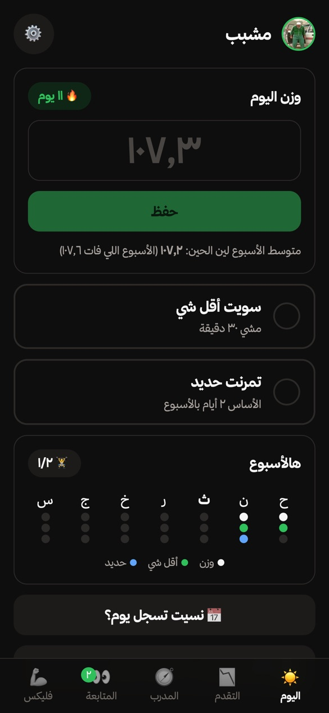
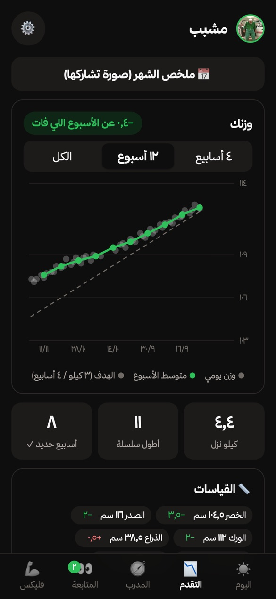
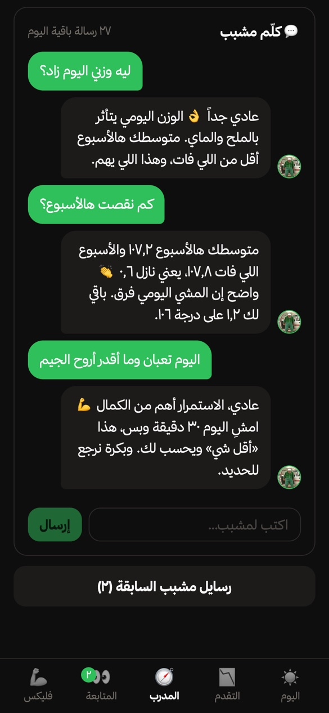
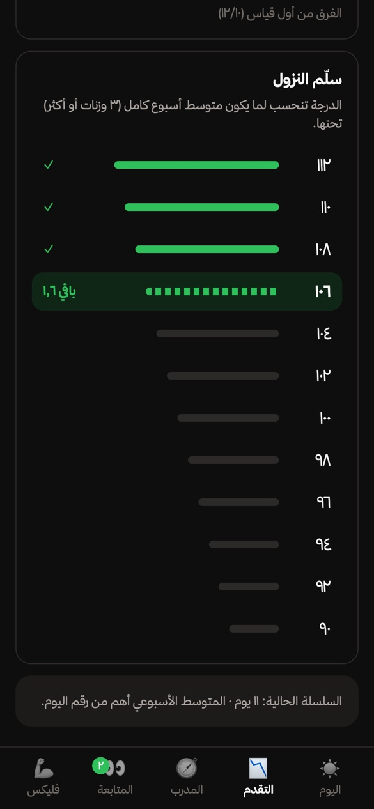
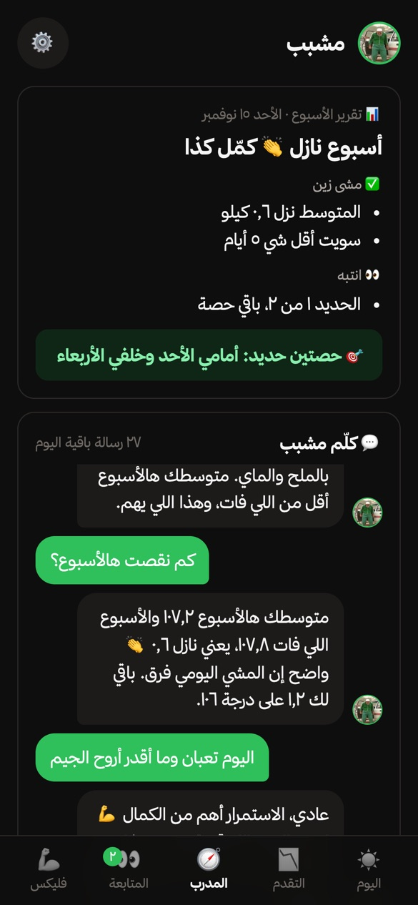
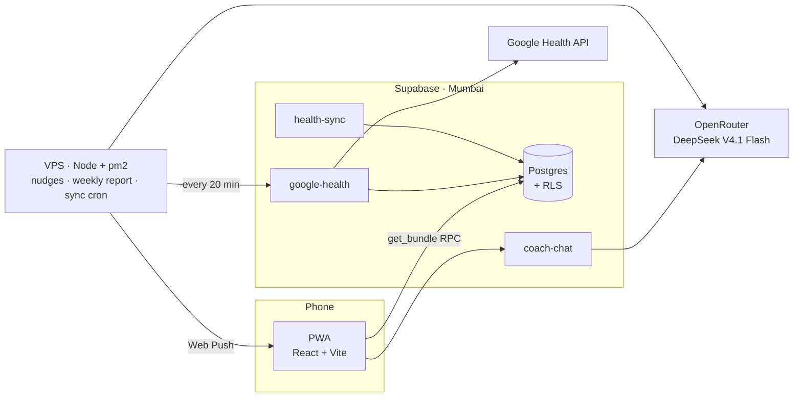

<div align="center">


# مشبب · Mushabbab

**Your Arabic fitness coach that judges progress by the week, not the day.**

مدرّبك اللي يشوف متوسط الأسبوع، مو رقم الصبح.

[**Open the app →**](https://mushabbab.faisalalthuwaini.sa)


</div>

<p align="center">
  
  
  
  
</p>

---

## 💡 Why

Your weight swings by a kilo or more from one day to the next: water, salt, sleep, when you last ate. Judge yourself by one morning and progress looks random. That's usually when people quit.

Mushabbab does two things about it:

- 📊 **It averages your weigh-ins per week** (Sunday to Saturday) and compares weeks, so you see the real trend.
- 🔁 **It has one rule: don't miss twice.** On a bad day the bare minimum («أقل شي», say a 30-minute walk) still counts and keeps the streak alive.

## ✨ Features

### ☀️ Today
Log your weight in one tap, in Arabic or Latin digits (`١١٢٫٤` or `112.4`). Tick «أقل شي» and «حديد» (lifting), or let them tick themselves from your watch. Your step meter, last night's sleep and the week's dots sit on one screen. Forgot a day? Log any past day.

### 📈 Progress
Weekly averages, the change from last week, your streak, and a **ladder** of the next weight milestones since you started. One tap makes a **monthly summary image** to share.

### 🤖 AI coach
Chat with مشبب, who knows your numbers: weights, streaks, steps, sleep and workouts. Smart nudges (morning, evening, missed-day rescue), a **weekly report**, and an early warning if the trend turns. If the AI is down, templates step in.

### 👀 A friend who watches
Invite a friend with a code. They see your feed (meals, check-ins, the photos you choose to share, measurements), react, comment and get notified. You see «👀 شافه» when they've seen something. Rename or remove a watcher any time.

### 💪 Flex
Progress photos (up to 4 per post, in a carousel). The weight is filled in from your latest weigh-in, and you can add body measurements: waist, chest, arm and more. Share each post or keep it private.

### ⌚ Health sync
Link **Google Health** once. Steps, sleep and strength workouts (Fitbit, plus Hevy through Apple Health) sync every 20 minutes:

- 👣 Reach your step goal → «أقل شي ✅»
- 🏋️ 20+ minutes of strength → «حديد ✅»
- 🔀 The same session logged twice (Hevy + Fitbit auto-detect) is merged

An Apple Health Shortcut is available as a fallback.

### 📱 Feels like an app
Installs to your home screen, with push notifications, dark mode, and right-to-left Arabic in the Thmanyah typeface. It opens instantly from a device cache, queues writes while you're offline, and keeps you signed in.

<table>
  <tr>
    <td align="center" width="50%"><br/><sub>Weekly report from the AI coach</sub></td>
    <td align="center" width="50%"><br/><sub>Shareable monthly summary</sub></td>
  </tr>
</table>

## 🏗️ How it's built



| Part | Choice |
|---|---|
| **App** | React + TypeScript + Vite, `vite-plugin-pwa` with a custom service worker, hosted on Netlify |
| **Data** | Supabase Postgres in Mumbai with row-level security. One RPC (`get_bundle`) loads a whole screen |
| **Auth** | Supabase email + password. A Telegram account links with a one-time code |
| **Server** | Supabase Edge Functions: `coach-chat`, `google-health`, `health-sync` |
| **Jobs** | Node.js + node-cron under pm2: nudges, weekly report, Google Health sync |
| **AI** | OpenRouter: `deepseek/deepseek-v4.1-flash`, with fallback `openai/gpt-oss-120b` |
| **Push** | Web Push (VAPID) |

All stats and coaching logic lives once in [`shared/`](shared/) and is used by the app, the jobs and the edge functions. `scripts/sync-shared.sh` copies it, and a test fails if the copies drift. Every design decision is logged in [`DECISIONS.md`](DECISIONS.md).

<details>
<summary><b>📁 Project structure</b></summary>

```
pwa/                    the app
  src/screens/          Today, Progress, Coach, Feed, Flex, Settings
  src/lib/              data layer, stats, offline queue
src/                    jobs + the original Telegram bot
  coachTick.js          nudges, milestones, weekly report, Google sync cron
  coachAI.js            LLM weekly report and trend alert
shared/                 stats.mjs + coach.mjs, the single source of truth
supabase/
  schema.sql            base schema
  migrations/           applied in order
  functions/            edge functions (_shared/ is generated)
test/                   npm test
```

</details>

## 🚀 Run your own

<details>
<summary><b>Setup steps</b></summary>

1. **Supabase:** create a project, run `supabase/schema.sql`, then every file in `supabase/migrations/` in order.
2. **Jobs:** `cp .env.example .env` and fill in:
   - `BOT_TOKEN`, `SUPABASE_URL` and `SUPABASE_SERVICE_ROLE_KEY`
   - the VAPID keys (`npx web-push generate-vapid-keys`)
   - optionally, `OPENROUTER_API_KEY`

   Then:
   ```bash
   npm install && pm2 start src/index.js --name mshabib-bot
   ```
3. **App:** `cp pwa/.env.example pwa/.env.local` and fill in the public URL, anon key and VAPID public key. The Thmanyah font files aren't in git; put them in `pwa/public/fonts/thmanyah/`. Then:
   ```bash
   cd pwa && npm install && npm run build && npx netlify deploy --prod --dir dist
   ```
4. **Edge functions:**
   ```bash
   npm run deploy:chat && npm run deploy:health && npm run deploy:google
   ```
   Set these secrets on the Supabase project: `OPENROUTER_API_KEY`, `GOOGLE_CLIENT_ID` and `GOOGLE_CLIENT_SECRET`.
5. **Google Health (optional):** in Google Cloud:
   - enable the Google Health API;
   - add the scopes `googlehealth.activity_and_fitness.readonly` and `googlehealth.sleep.readonly`;
   - publish the consent screen to **In production** (in *Testing*, the link expires after 7 days);
   - create a Web OAuth client with the redirect URI `https://<project-ref>.supabase.co/functions/v1/google-health`.

</details>

---

<div align="center">
<sub>Built in Riyadh 🇸🇦 · MIT License</sub>
</div>
